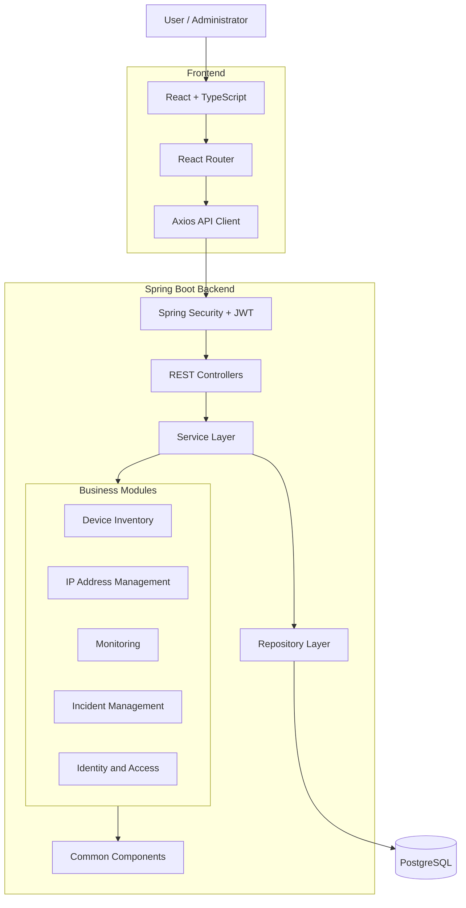

# garud-network
Garud Network is an enterprise-grade platform for managing and monitoring IT infrastructure. It enables organizations to track network devices, manage IP addresses, monitor server health, detect downtime, handle incidents, and receive real-time alerts through a centralized dashboard.

---

## 1. Project Overview

**GARUD** is a full-stack Network Operations and Infrastructure Management Platform designed to centralize the management, monitoring, and operational administration of network infrastructure.

The platform aims to provide network administrators and IT operations teams with a unified interface to manage network devices, IP address allocations, infrastructure health, incidents, alerts, and operational activities.

The application follows a modular monolithic architecture with a RESTful backend and a modern web-based frontend.

The project is being developed using enterprise-oriented development practices, including layered architecture, role-based access control, centralized exception handling, database migrations, API versioning, automated testing, containerization, and CI/CD.

### Project Objectives

- Centralize network device inventory management.
- Manage IP address allocation and network resources.
- Monitor infrastructure availability and health.
- Track incidents and operational issues.
- Manage user access through role-based authorization.
- Provide operational dashboards and analytics.
- Maintain audit trails for important activities.
- Establish a scalable foundation for future infrastructure integrations.

---

## 2. Key Features

The platform is being developed around the following functional modules.

| Module | Description | Status |
|---|---|---|
| Device Inventory | Manage routers, switches, firewalls, servers, and other devices | In progress |
| IP Address Management | Manage IP addresses, subnets, and allocation records | Planned |
| Infrastructure Monitoring | Monitor device availability and health | Planned |
| Incident Management | Create, assign, and track operational incidents | Planned |
| SLA Management | Track service-level targets and escalation rules | Planned |
| Notifications | Deliver alerts and operational notifications | Planned |
| User Management | Manage application users | In progress |
| Role-Based Access Control | Control access using roles and permissions | In progress |
| Dashboard & Analytics | Display operational information and metrics | Planned |
| Audit Logging | Maintain records of important application activities | Planned |

**Development status:** Approximately 80% of the project work has been uploaded, according to the current development progress. Individual features are still subject to implementation, integration, and testing.

---

## 3. Technology Stack

### Backend

| Technology | Purpose |
|---|---|
| Java 21 | Primary programming language |
| Spring Boot | Backend application framework |
| Spring Web | REST API development |
| Spring Data JPA | Database persistence |
| Hibernate | ORM implementation |
| Spring Security | Authentication and authorization |
| JWT | Access-token authentication |
| Maven | Dependency and build management |
| Flyway | Database version control |
| Spring Boot Actuator | Application health and metrics |
| JUnit 5 | Unit and integration testing |
| Mockito | Mock-based testing |
| Testcontainers | Database-backed integration testing |

### Frontend

| Technology | Purpose |
|---|---|
| React | User interface |
| TypeScript | Type-safe frontend development |
| Vite | Frontend build tooling |
| React Router | Client-side routing |
| Axios | HTTP communication |
| CSS | Application styling |

### Database & Infrastructure

| Technology | Purpose |
|---|---|
| PostgreSQL | Primary relational database |
| Docker | Application containerization |
| Docker Compose | Multi-container orchestration |
| Nginx | Reverse proxy and web server |
| GitHub Actions | CI/CD automation |
| Prometheus | Metrics collection |
| Grafana | Metrics visualization |
| Ubuntu Server | Deployment environment |

---

## 4. System Architecture

GARUD follows a **Modular Monolithic Architecture**.

The backend is organized into independent business modules within a single Spring Boot application. Each module owns its business logic and related persistence components.

The frontend communicates with the backend through versioned REST APIs.



### Architectural Principles

- Separation of concerns.
- Controller-Service-Repository pattern.
- DTO-based API communication.
- Centralized exception handling.
- Dependency injection.
- RESTful API conventions.
- Stateless access-token authentication.
- Role and permission-based authorization.
- Database schema versioning through Flyway.
- Configuration separation using Spring profiles.

---

## 5. Project Structure

The repository follows a feature-oriented backend structure and a feature-oriented frontend structure.

### Backend Structure

```text
backend/
├── src/
│   ├── main/
│   │   ├── java/
│   │   │   └── com/garud/network/
│   │   │       ├── GarudNetworkApplication.java
│   │   │       │
│   │   │       ├── config/
│   │   │       │
│   │   │       ├── common/
│   │   │       │   ├── exception/
│   │   │       │   ├── response/
│   │   │       │   ├── logging/
│   │   │       │   ├── security/
│   │   │       │   └── util/
│   │   │       │
│   │   │       ├── identity/
│   │   │       │   ├── user/
│   │   │       │   ├── role/
│   │   │       │   ├── permission/
│   │   │       │   └── auth/
│   │   │       │
│   │   │       ├── device/
│   │   │       │   ├── dto/
│   │   │       │   ├── Device.java
│   │   │       │   ├── DeviceRepository.java
│   │   │       │   ├── DeviceService.java
│   │   │       │   ├── DeviceServiceImpl.java
│   │   │       │   ├── DeviceController.java
│   │   │       │   ├── DeviceMapper.java
│   │   │       │   └── DeviceSpecification.java
│   │   │       │
│   │   │       ├── ipam/
│   │   │       ├── monitoring/
│   │   │       ├── incident/
│   │   │       ├── sla/
│   │   │       ├── notification/
│   │   │       ├── audit/
│   │   │       └── dashboard/
│   │   │
│   │   └── resources/
│   │       ├── application.properties
│   │       ├── application-dev.properties
│   │       ├── application-test.properties
│   │       ├── application-prod.properties
│   │       └── db/
│   │           └── migration/
│   │
│   └── test/
│       └── 
│
├── pom.xml
├── mvnw
└── mvnw.cmd
```

### Frontend Structure

```text
frontend/
├── src/
│   ├── app/
│   │   ├── App.tsx
│   │   └── router.tsx
│   │
│   ├── assets/
│   │
│   ├── components/
│   │   ├── common/
│   │   └── layout/
│   │
│   ├── features/
│   │   ├── auth/
│   │   ├── dashboard/
│   │   ├── inventory/
│   │   ├── ipam/
│   │   ├── monitoring/
│   │   └── incidents/
│   │
│   ├── hooks/
│   ├── services/
│   ├── types/
│   ├── utils/
│   ├── styles/
│   └── main.tsx
│
├── public/
├── package.json
└── vite.config.ts
```

---

## 6. Backend Development Standards

The backend follows a layered development approach.

| Layer | Responsibility |
|---|---|
| Controller | Handles HTTP requests and responses |
| Service | Implements business logic |
| Repository | Handles database operations |
| Entity | Represents persistent database data |
| DTO | Defines API request and response structures |
| Mapper | Converts entities into DTOs and vice versa |
| Specification | Builds dynamic database search queries |
| Exception Handler | Handles application exceptions centrally |

### API Versioning

All REST APIs follow the versioned URL convention:

```text
/api/v1/
```

Example device endpoints:

| HTTP Method | Endpoint | Purpose |
|---|---|---|
| POST | `/api/v1/devices` | Create a device |
| GET | `/api/v1/devices` | Retrieve devices |
| GET | `/api/v1/devices/{id}` | Retrieve device details |
| PUT | `/api/v1/devices/{id}` | Update a device |
| DELETE | `/api/v1/devices/{id}` | Delete a device |
| GET | `/api/v1/devices/search` | Search and filter devices |

API documentation is planned through Springdoc OpenAPI.

---

## 7. Authentication & Authorization

The application uses Spring Security and JWT-based authentication.

The security design includes:

- User authentication.
- Password hashing using BCrypt.
- Short-lived JWT access tokens.
- Refresh-token management.
- Refresh-token revocation and rotation.
- Role-based access control (RBAC).
- Permission-based endpoint authorization.
- Protected REST APIs.
- CORS configuration.
- CSRF protection for cookie-based authentication flows.

### Planned Application Roles

| Role | Responsibility |
|---|---|
| ROLE_ADMIN | Full application administration |
| ROLE_NETWORK_ENGINEER | Network infrastructure operations |
| ROLE_NOC_OPERATOR | Network operations and incident handling |
| ROLE_ANALYST | Read-only operational reporting |

Permissions follow the resource-action convention.

Examples:

```text
device:create
device:read
device:update
device:delete
```

---

## 8. Database

PostgreSQL is the primary database.

Spring Data JPA and Hibernate are used for persistence and object-relational mapping.

Flyway manages database schema changes through versioned migration scripts.

Migration directory:

```text
backend/src/main/resources/db/migration/
```

Example migration naming convention:

```text
V1__create_initial_schema.sql
V2__create_devices_table.sql
V3__add_device_constraints.sql
```

Database design principles:

- Primary and foreign key constraints.
- Appropriate unique constraints.
- Indexes for frequently searched columns.
- Consistent audit timestamps.
- Transaction management.
- Controlled database schema evolution.

---

## 9. Prerequisites

Install the following software before running the application locally:

| Software | Version |
|---|---|
| Java JDK | 21 |
| Maven | Wrapper included in project |
| Node.js | 22 or compatible |
| npm | Compatible with Node.js |
| PostgreSQL | Supported current release |
| Git | Latest stable |
| Docker Desktop | Optional for local container development |

---

## 10. Local Development Setup

### Step 1: Clone the Repository

```bash
git clone <YOUR_GITHUB_REPOSITORY_URL>
```

```bash
cd server
```

### Step 2: Configure PostgreSQL

Create the development database:

```sql
CREATE DATABASE garud_db;
```

Create the application user:

```sql
CREATE USER garud_app WITH PASSWORD 'change_this_password';
```

Grant database access:

```sql
GRANT ALL PRIVILEGES ON DATABASE garud_db TO garud_app;
```

Ensure the application user has the required schema privileges for your PostgreSQL version and schema configuration.

### Step 3: Configure Environment Variables

Configure the following environment variables:

```properties
GARUD_DB_URL=jdbc:postgresql://localhost:5432/garud_db
GARUD_DB_USERNAME=garud_app
GARUD_DB_PASSWORD=change_this_password
GARUD_SERVER_PORT=8080
SPRING_PROFILES_ACTIVE=dev
```

Do not commit real passwords, JWT signing keys, or other secrets to Git.

### Step 4: Run the Backend

Open a terminal:

```bash
cd backend
```

Build the application:

```bash
./mvnw clean verify
```

On Windows PowerShell:

```powershell
.\mvnw.cmd clean verify
```

Run the application:

```bash
./mvnw spring-boot:run
```

On Windows:

```powershell
.\mvnw.cmd spring-boot:run
```

Backend default URL:

```text
http://localhost:8080
```

### Step 5: Run the Frontend

Open another terminal:

```bash
cd frontend
```

Install dependencies:

```bash
npm install
```

Start the development server:

```bash
npm run dev
```

Frontend default URL:

```text
http://localhost:5173
```

---

## 11. Environment Configuration

The application supports separate Spring profiles:

| Profile | Purpose |
|---|---|
| dev | Local development |
| test | Automated testing |
| prod | Production deployment |

Frontend API configuration:

```properties
VITE_API_BASE_URL=http://localhost:8080/api/v1
```

Frontend variables prefixed with `VITE_` are exposed to browser code. Never place passwords, private keys, or other secrets in them.

---

## 12. Testing

The backend testing strategy uses:

- JUnit 5 for test cases.
- Mockito for service-layer unit tests.
- Spring Boot Test for application integration tests.
- Testcontainers for database integration testing.

Run backend tests:

```bash
cd backend
./mvnw test
```

Run the complete Maven verification:

```bash
./mvnw clean verify
```

Run frontend checks:

```bash
cd frontend
npm run build
```

Additional frontend test tooling can be integrated as the frontend testing suite is established.

---

## 13. Docker & Deployment

The deployment target is Ubuntu Server.

The planned production architecture uses:

```text
Internet / Home Network
        |
        v
      Nginx
        |
        v
  React Frontend
        |
        v
 Spring Boot Backend
        |
        v
    PostgreSQL
```

Docker Compose will be used to orchestrate application services.

Deployment components:

- Ubuntu Server.
- Docker Engine.
- Docker Compose.
- Nginx reverse proxy.
- Spring Boot backend container.
- React frontend container.
- PostgreSQL database.
- Environment-based production configuration.

Production deployment and security hardening are part of the ongoing roadmap.

---

## 14. Monitoring & Observability

The planned monitoring stack includes:

| Technology | Responsibility |
|---|---|
| Spring Boot Actuator | Application health and metrics endpoints |
| Prometheus | Metrics scraping and storage |
| Grafana | Monitoring dashboards |
| Application Logging | Application event and error tracking |

Future infrastructure monitoring capabilities may include device availability checks, health status tracking, alert generation, and operational metrics.


## 15. Future Enhancements

Potential improvements after the core modules are complete:

- Real network-device integrations.
- SNMP-based monitoring.
- Automated device discovery.
- Real-time dashboard updates.
- WebSocket-based notifications.
- Advanced reporting and analytics.
- TimescaleDB evaluation for high-volume time-series metrics.
- Redis evaluation for justified caching and coordination requirements.
- Integration with external alerting and incident-management services.

These enhancements will be introduced based on actual application requirements and operational needs.

---

## 17. Contributing

Contributions and suggestions are welcome.

For significant changes:

1. Fork the repository.
2. Create a feature branch.
3. Implement your changes.
4. Add or update tests.
5. Verify the application builds successfully.
6. Submit a pull request with a clear description.

---

## 18. License

This project is currently under development.

A license will be added when the project's distribution and usage terms are finalized.

---

## 19. Project Information

**Project Name:** GARUD  
**Project Type:** Full-Stack Network Management Platform  
**Backend:** Java 21 + Spring Boot  
**Frontend:** React + TypeScript  
**Database:** PostgreSQL  
**Architecture:** Modular Monolith  
**Deployment Target:** Ubuntu Server + Docker Compose  
**Development Status:** In Progress

---

**GARUD — Bringing Network Infrastructure Management Together.**

